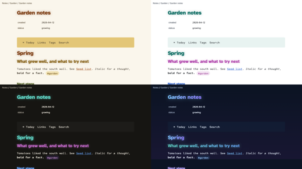

# Enough Light

A calm, legible Obsidian theme. Enough light to read by, nothing more.



| Light | | Dark | |
|---|---|---|---|
| **Honey** (default) | warm yellow paper; rust, amber, olive | **Arcane** (default) | teal, magenta, blue with a soft glow |
| **Slate** | cool blue-grey; navy, plum, teal | **Deep Sea** | navy paper; sky, aqua, lilac; optional ombre |
| **Sage** | soft green; forest, terracotta, indigo | **Ember** | warm brown; gold, copper, rose |
| **Daylight** | bright white; Arcane's colours by day | | |

- **Seven palettes:** light Honey · Slate · Sage · Daylight; dark Arcane · Deep Sea · Ember.
- **Optional effects:** heading glow (all palettes), ombre page fade and gradient headings (dark).
- **Per-heading controls** (H1–H6 colour, size, font, weight) and **four bundled font pairings** via the
  [Style Settings](https://github.com/mgmeyers/obsidian-style-settings) plugin.
- **Legibility is tested, not eyeballed:** body ≥ 7:1, headings ≥ 5.5:1, other text ≥ 4.5:1, on page and sidebar.
- **Say it once:** every colour lives in `src/palettes.mjs`; each element gets one visual signal.

## Install

- **From Obsidian:** Settings → Appearance → Themes → **Manage** → search *Enough Light* → Install and use.
- **By hand:** download `theme.css` and `manifest.json` from the
  [latest release](https://github.com/godlen4332/obsidian-enough-light/releases/latest) into
  `<your vault>/.obsidian/themes/Enough Light/`, then pick it under Settings → Appearance → Themes.

**Customise it:** install the [Style Settings](https://github.com/mgmeyers/obsidian-style-settings)
plugin, then Settings → Style Settings → Enough Light. You can set:

- the palette, separately for light and dark mode (each picker and its samples of every palette sit in one card, with the one in use ticked);
- whether to use Obsidian's own accent colour (Settings → Appearance → Accent color) instead of the palette's;
- colours for bold, italic and highlighted text;
- the width of the text column (when *Readable line length* is on);
- heading glow (on by default) and the dark-mode gradient effects;
- the font pairing;
- colour, size, font and weight for each heading level, with live samples (all six together, and each level in its own section) that update as you change them.

Without Style Settings you get Honey (light) and Arcane (dark).

**Fonts:** the bundled fonts only show when Settings → Appearance → *Text font* and *Interface font* are
empty, because those fields override any theme.

**Other devices:** with Obsidian Sync, turn on *Installed themes and snippets* and *Appearance settings*
on **each** device, then restart Obsidian there.

**Your own Mac fonts on iPhone/iPad:** Obsidian on iOS can't use fonts installed on the phone, and Sync copies
font *names*, not files. `scripts/personal-fonts.sh "<vault>"` embeds the fonts your Appearance settings use
into a vault snippet; turn it on under Appearance → CSS snippets. The output stays in your vault and is never
committed (some fonts are personally licensed).

## Develop

```bash
npm test                                    # legibility + build + font + manifest contracts
npm run build                               # writes theme.css (≈ 530 KB, fonts embedded)
npm run dev -- "<vault path>" [--watch]     # build + install into a vault
./scripts/preview.sh                        # screenshots on Obsidian's real app.css → preview/out/, cover.png
./scripts/fetch-fonts.sh                    # rebuild fonts/woff2 from google/fonts (needs uv)
```

Edit `src/`, never `theme.css`. Design: [docs/enough-light-design.md](docs/enough-light-design.md) ·
Plan: [docs/enough-light-plan.md](docs/enough-light-plan.md)

## Licence

MIT (see `LICENSE`). Bundled fonts are SIL Open Font License 1.1, see `fonts/licenses/`.
